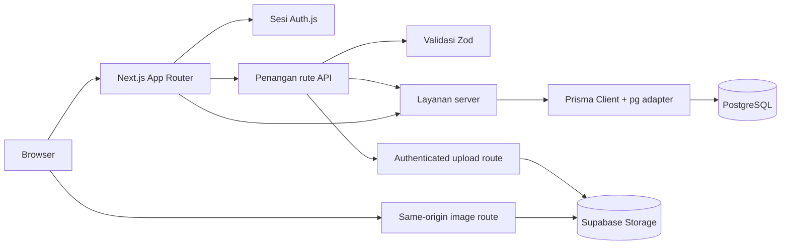

# RuangLagi — Pasar Barang Preloved

MVP pasar barang preloved untuk kebutuhan anak kos, dibangun dengan Next.js App Router, PostgreSQL, dan Prisma. README ini menjelaskan implementasi aktual; fitur yang masih menunggu pemeriksaan langsung ditandai.

## Gambaran umum

Pengunjung dapat melihat katalog dan toko publik. Pengguna terdaftar dapat menjadi pembeli dan penjual, mengelola produk/profil, menyimpan favorit, membuat pesanan, dan mengikuti notifikasi. Administrator dapat mengelola akun, produk, pesanan, alamat, dan log audit melalui area admin.

Permintaan halaman dirender melalui App Router. Data utama dibaca dan diubah oleh Server Component, penangan rute API, serta layanan server yang memakai Prisma. Perubahan melalui API mendapatkan identitas dari sesi Auth.js; masukan divalidasi dengan Zod. Data tersimpan di PostgreSQL, sedangkan gambar unggahan disimpan di Supabase Storage. SVG data awal tetap berada di `public/products/`.

## Status Saat Ini

- Implementasi terakhir yang tercatat: tindak lanjut Tahap 6, Area Admin Fase 2; audit dan perbaikan UI setelahnya tidak menambah tahap.
- Tahap 6 dan tindak lanjut yang tercatat telah diimplementasikan, tetapi verifikasi langsung pada Preview dan uji browser menyeluruh masih tertunda.
- README ini disusun berdasarkan keadaan repo dan catatan verifikasi 2026-10-15.
- Perapian UI terakhir: kartu `ProductGrid` memiliki foto `object-cover` berinset sekitar 10 px, rounded clipping, hover scale 1,015x/naik 2 px, zoom gambar 1,02x, dan feedback tekan. Gerakan hormat pada `prefers-reduced-motion`; badge, favorit, serta tombol Jual mempertahankan fungsi.
- Beranda menampilkan showcase carousel maksimal tiga produk aktif dengan foto unik, lengkung pintu tetap seperti desain awal (radius atas 170 px), frame desktop setinggi 520 px, tanpa ilustrasi kardus, serta judul/harga transparan dan indikator titik di dalam foto. Gambar produk diperbesar 10%, terpotong mengikuti arch dan wrapper tiap slide agar zoom tidak menimpa gambar slide lain. Banner hijau desktop dibatasi 560 px. Slide berganti otomatis tiap 4,5 detik, berputar mulus dari slide terakhir ke pertama maupun sebaliknya, jeda selama drag, dan timer mulai ulang setelah slide berganti; mouse/touch drag menampilkan pergeseran langsung selama tarikan; trackpad horizontal dan tombol panah keyboard juga dapat mengganti slide tanpa tombol visual. Produk yang tampil di slideshow juga tetap ada di kartu katalog beranda.

## Fitur yang Sudah Diimplementasikan

- Pendaftaran dan masuk menggunakan email/kata sandi dengan bcrypt; Google OAuth tersedia secara opsional jika kedua kredensial server diatur.
- Katalog, detail produk, pencarian/filter/pengurutan/paginasi, toko publik, dasbor penjual, serta pembuatan, penyuntingan, dan pengarsipan produk.
- Favorit privat, pesanan, perubahan status pesanan, dan notifikasi dalam aplikasi.
- Profil pengguna, avatar, bio, daftar alamat, pengaturan notifikasi, profil toko, mode liburan, dan akun pembayaran penjual.
- Area admin untuk mengelola akun/produk/pesanan dengan pencatatan audit.
- Unggah gambar produk/avatar/logo melalui endpoint server ke Supabase Storage; gambar dibaca melalui rute dari origin yang sama. Batas aplikasi 3.000.000 byte per berkas, dengan tipe JPEG/PNG/WebP.
- Enkripsi AES-256-GCM untuk nomor rekening pembayaran dan snapshot instruksi pembayaran.

## Teknologi yang Digunakan

- Next.js 16.4.0 App Router, React 19.3.0, TypeScript strict.
- Tailwind CSS 4, Radix UI, Lucide, Sonner.
- Zod 4, React Hook Form, `@hookform/resolvers`.
- PostgreSQL, Prisma 7.10.0 dengan adapter `pg`.
- Auth.js 5 beta dengan Credentials dan JWT, bcryptjs.
- Vitest 2 untuk pengujian unit/komponen; ESLint 9 dan Prettier 3.

Versi di atas berasal dari `package.json`/lockfile saat README ini diperiksa. `package-lock.json` menunjukkan npm sebagai pengelola paket.

## Arsitektur dan Alur Data



Pada perubahan melalui API, rute memeriksa sesi aktif, mengambil ID pengguna dari sesi, memvalidasi masukan, memanggil layanan, lalu mengembalikan hasil bertipe. Layanan menegakkan kepemilikan dan aturan status, serta memakai transaksi database untuk perubahan pesanan/produk yang saling terkait dan catatan audit admin. Halaman atau formulir menampilkan hasilnya. DTO produk/toko publik tidak menyertakan data akun privat; informasi kontak pada pesanan disesuaikan dengan peran pengguna dan status pesanan.

## Peta Direktori

```text
src/
  app/                  Halaman, layout, status loading/error, dan rute API
    api/                Auth, produk, pesanan, favorit, profil, unggahan, admin, notifikasi
  components/           Formulir, layout, produk, profil, pesanan, admin, UI
  generated/prisma/     Prisma Client hasil generate (dibuat oleh prisma generate)
  lib/                  Klien DB, helper auth, pemformatan, dukungan skema, utilitas bersama
  schemas/              Skema masukan Zod
  server/
    actions/            Server actions (termasuk auth)
    admin/              Otorisasi admin dan helper HTTP
    security/           Enkripsi pembayaran dan pemeriksaan/diagnostik staging
    services/           Operasi domain/database
    storage/            Adapter penyimpanan gambar lokal dan Supabase
  types/                DTO dan tipe sesi Auth.js
prisma/
  schema.prisma         Model PostgreSQL, enum, relasi, dan indeks
  migrations/           Migrasi SQL berurutan
  seed.ts               Titik awal pengisian data awal database
  verify-constraints.ts Helper untuk memeriksa batasan database
scripts/                Utilitas inisialisasi admin, migrasi penyimpanan, staging, dan pembayaran
docs/                   Blueprint, keputusan desain, audit, QA, dan daftar periksa staging
public/products/        Berkas SVG produk bawaan untuk data awal
```

Titik masuk penting: `src/app/layout.tsx` (layout utama), `src/app/page.tsx` (beranda), `auth.ts` (konfigurasi Auth.js), `src/lib/db.ts` (pool Prisma/pg), `src/schemas/index.ts` (skema masukan), dan `src/server/services/` (akses data domain). `src/instrumentation.ts` memvalidasi kunci enkripsi pembayaran saat runtime Node.js dimulai, kecuali saat build produksi.

### Alur fitur: autentikasi

Halaman `/login` dan `/register` menggunakan formulir di `src/components/forms/`. Pendaftaran dikirim ke `/api/auth/register`; `src/server/actions/auth.ts` dan `src/lib/auth/credentials.ts` menangani pembuatan akun dan pemeriksaan kredensial. `auth.ts` mengatur Credentials, Google opsional, sesi JWT, dan handler `/api/auth/[...nextauth]`. Halaman terlindungi memeriksa sesi di server; status akun dan versi sesi dicocokkan dengan PostgreSQL. Login Google menerima email terverifikasi dan mencari pengguna berdasarkan email yang dinormalisasi. Tidak ada tabel atau adapter OAuth Account, sehingga ID subjek Google tidak disimpan.

### Alur fitur: produk, favorit, dan pesanan

Halaman katalog/detail/dasbor di `src/app/` memanggil layanan produk di `src/server/services/products.ts`. Rute API produk ada di `/api/products`; favorit memakai `/api/favorites` dan relasi `Favorite`. Halaman/formulir pesanan memanggil `/api/orders` yang ditangani `src/server/services/orders.ts`. Layanan pesanan memvalidasi perubahan status, memeriksa peran pembeli/penjual, menyimpan snapshot checkout/pembayaran, mengubah status produk dalam transaksi, dan membuat notifikasi. Selama pesanan berstatus pending, produk tetap active; konfirmasi mengubahnya menjadi reserved, penyelesaian menjadi sold, dan pembatalan pesanan yang sudah dikonfirmasi mengembalikannya ke active. Indeks unik parsial database membatasi satu produk memiliki maksimal satu pesanan pending/confirmed.

### Alur fitur: profil, toko, notifikasi, administrasi

Rute profil dan pusat profil berada di `/api/profile`; layanan terkait mengelola profil, kata sandi, alamat, toko penjual, preferensi notifikasi, dan akun pembayaran. Nomor akun pembayaran dan instruksi pembayaran pesanan dienkripsi saat disimpan oleh `src/server/security/payment-encryption.ts`; daftar akun hanya menampilkan digit yang disamarkan. Toko publik menggunakan `/store/[slug]` dan DTO dengan daftar izin. API notifikasi berada di `/api/notifications`. Halaman admin di `/admin` memanggil `/api/admin/*`; `src/server/admin/authorization.ts` membatasi akses admin, dan perubahan admin yang transaksional mencatat metadata audit yang diizinkan.

### Alur fitur: unggah gambar

`src/components/forms/image-uploader.tsx` mengirim gambar yang dipilih ke `/api/uploads`. Rute ini mewajibkan pengguna terautentikasi, memvalidasi MIME/ukuran/tujuan, lalu memakai `src/server/storage/supabase-image-storage.ts` (atau adapter lokal yang dikonfigurasi) dan menyimpan metadata pemilik/tujuan melalui `src/server/services/uploaded-files.ts`. Gambar disajikan melalui `/uploads/[filename]`; kunci divalidasi sebelum rute mengalihkan ke bucket publik. Kredensial Supabase hanya digunakan di server. Skrip migrasi gambar lokal menyalin berkas tanpa menghapus sumbernya.

## Database dan Pengelolaan Data

Satu-satunya provider sumber data Prisma yang dikonfigurasi adalah PostgreSQL. `prisma/schema.prisma` mendefinisikan:

| Model                                    | Fungsi dan relasi                                                                                                                |
| ---------------------------------------- | -------------------------------------------------------------------------------------------------------------------------------- |
| `User`                                   | Identitas login, profil, peran, versi sesi; memiliki produk, favorit, pesanan, alamat, profil penjual, unggahan, dan notifikasi. |
| `Category`                               | Taksonomi produk yang dikelola di database.                                                                                      |
| `Product`, `ProductImage`                | Produk milik penjual, kategori, status, dan referensi gambar berurutan.                                                          |
| `Favorite`                               | Relasi pengguna/produk dengan kunci utama gabungan.                                                                              |
| `Order`                                  | Referensi pembeli, penjual, produk, snapshot checkout yang tetap, dan status.                                                    |
| `Address`                                | Alamat kirim/ambil milik pengguna, maksimal satu alamat utama per jenis.                                                         |
| `SellerProfile`, `PaymentAccount`        | Detail toko publik dan nomor akun pembayaran terenkripsi.                                                                        |
| `UploadedFile`                           | Metadata pemilik dan tujuan unggahan.                                                                                            |
| `Notification`, `NotificationPreference` | Notifikasi pesanan dan preferensi yang dibatasi per pemilik.                                                                     |
| `AuditLog`                               | Metadata tindakan admin dan referensi pelaku.                                                                                    |

Migrasi berada di `prisma/migrations/`; `prisma/seed.ts` menggunakan data contoh dari `src/lib/seed-data.ts`. Aplikasi memakai pool `pg` dengan maksimal satu koneksi per instance Prisma Client. Konfigurasi ini belum membuktikan bahwa batas koneksi pada deployment serverless telah teratasi. Gunakan database development/staging terisolasi untuk migrasi dan pengisian data awal; jangan arahkan perintah tersebut ke production tanpa pemeriksaan.

## Prasyarat

- Node.js 20.9.0 atau lebih baru (persyaratan runtime paket Next.js).
- npm (berkas lockfile: `package-lock.json`).
- Database PostgreSQL untuk halaman aplikasi dan operasi Prisma.
- Proyek Supabase dan bucket Storage untuk unggah gambar jarak jauh; aplikasi juga memerlukan kunci enkripsi pembayaran saat dimulai.

## Instalasi dan Konfigurasi

Gunakan PowerShell:

```powershell
Set-Location 'F:\Documents\Program\Next JS\preloved'
npm ci
Copy-Item .env.example .env.local
```

Edit `.env.local` di komputer Anda. Jangan commit atau membagikan nilai rahasia. `prisma.config.ts` memuat `.env.local` dan `.env` saat Prisma CLI dijalankan.

| Variabel                                                                                               | Fungsi                                                                                       |
| ------------------------------------------------------------------------------------------------------ | -------------------------------------------------------------------------------------------- |
| `DATABASE_URL`                                                                                         | Koneksi PostgreSQL untuk aplikasi dan Prisma CLI.                                            |
| `AUTH_SECRET`                                                                                          | Rahasia sesi/JWT Auth.js.                                                                    |
| `AUTH_GOOGLE_ID`, `AUTH_GOOGLE_SECRET`                                                                 | Google OAuth opsional; isi keduanya dan daftarkan `/api/auth/callback/google` pada penyedia. |
| `NEXT_ALLOWED_DEV_ORIGIN`                                                                              | Hostname/IP LAN opsional untuk development lokal; tanpa skema atau port.                     |
| `UPLOAD_DIR`                                                                                           | Direktori unggahan lokal untuk adapter penyimpanan lokal.                                    |
| `SUPABASE_URL`, `SUPABASE_STORAGE_BUCKET`                                                              | Proyek dan bucket Supabase Storage untuk media unggahan.                                     |
| `SUPABASE_SECRET_KEY` atau `SUPABASE_SERVICE_ROLE_KEY`                                                 | Kredensial Storage khusus server; utamakan secret key. Jangan gunakan awalan `NEXT_PUBLIC_`. |
| `PAYMENT_ENCRYPTION_KEY`                                                                               | Kunci AES 32 byte berformat base64 khusus server; wajib untuk data pembayaran.               |
| `PAYMENT_ENCRYPTION_KEY_V2`                                                                            | Kunci versi berikutnya yang opsional selama proses rotasi kunci.                             |
| `SHADOW_DATABASE_URL`                                                                                  | Koneksi shadow database Prisma opsional.                                                     |
| `ADMIN_BOOTSTRAP_EMAIL`, `ADMIN_BOOTSTRAP_PASSWORD`                                                    | Masukan sementara untuk perintah bootstrap admin; hapus setelah digunakan.                   |
| `STAGING_PROJECT_REF`, `PRODUCTION_PROJECT_REF`, `STAGING_STORAGE_BUCKET`, `PRODUCTION_STORAGE_BUCKET` | Nilai pemeriksaan target untuk validasi staging dan skrip enkripsi ulang pembayaran.         |
| `DEPLOYMENT_ENV`                                                                                       | Penanda lingkungan eksplisit opsional yang digunakan pemeriksaan keamanan seed.              |

`PAYMENT_ENCRYPTION_KEY` dapat dibuat secara lokal dengan perintah di `.env.example`; jaga agar hasilnya tetap rahasia. Jangan mengonfigurasi variabel R2 untuk aplikasi ini: implementasi unggah saat ini menggunakan Supabase Storage. `.env.example` masih memuat placeholder R2 lama, tetapi kode aplikasi tidak membacanya.

Siapkan database non-production yang memang ditujukan untuk development, lalu jalankan:

```powershell
npm run db:validate
npm run db:migrate
npm run db:seed
```

`db:migrate` menerapkan migrasi yang tertunda dan `db:seed` menulis data contoh. Jalankan hanya jika `DATABASE_URL` mengarah ke database yang memang ingin diubah. `npm run staging:verify` adalah pemeriksaan target/koneksi staging yang terpisah dan hanya-baca; konfigurasi staging dijelaskan di `docs/STAGING-E2E-CHECKLIST.md`.

## Menjalankan Aplikasi

```powershell
npm run dev
```

Buka <http://localhost:3000>. Untuk jaringan lokal tepercaya saja, `npm run dev:lan` mengikat server ke `0.0.0.0`; atur `NEXT_ALLOWED_DEV_ORIGIN` jika diperlukan dan ikuti kebijakan firewall perangkat/jaringan. Jangan paparkan server development ke jaringan yang tidak tepercaya.

Build produksi dan server lokal:

```powershell
npm run build
npm run start
```

Skrip `start` memerlukan build yang berhasil terlebih dahulu. Konfigurasi penyedia deployment tidak didefinisikan dalam manifest deployment di repo; atur variabel lingkungan dan callback penyedia pada platform hosting yang digunakan.

## Skrip dan Perintah Penting

| Perintah                                                                            | Fungsi                                                                                           |
| ----------------------------------------------------------------------------------- | ------------------------------------------------------------------------------------------------ |
| `npm run dev`, `npm run dev:lan`                                                    | Server development lokal, biasa atau terikat ke jaringan LAN.                                    |
| `npm run build`, `npm run start`                                                    | Build dan server production.                                                                     |
| `npm run typecheck`                                                                 | Pemeriksaan TypeScript (`tsc --noEmit`).                                                         |
| `npm run lint`                                                                      | Menjalankan ESLint.                                                                              |
| `npm test`                                                                          | Menjalankan rangkaian test Vitest.                                                               |
| `npm run format:check`, `npm run format`                                            | Memeriksa format atau menulis ulang format berkas yang didukung.                                 |
| `npm run db:generate`                                                               | Membuat Prisma Client; juga dipanggil oleh `postinstall`.                                        |
| `npm run db:validate`, `npm run db:status`, `npm run db:migrate`, `npm run db:seed` | Memvalidasi skema, memeriksa status migrasi, menerapkan migrasi, dan mengisi data awal database. |
| `npm run db:verify`                                                                 | Menjalankan helper pemeriksaan constraint pada database yang dikonfigurasi.                      |
| `npm run staging:verify`                                                            | Memeriksa pemisahan target staging/production dan melakukan probe koneksi staging hanya-baca.    |
| `npm run admin:bootstrap`                                                           | Membuat akun admin secara eksplisit menggunakan kredensial environment sementara.                |
| `npm run payments:reencrypt`                                                        | Utilitas enkripsi ulang ciphertext pembayaran dengan pemeriksaan target staging/production.      |

## Keputusan Penting

- `passwordHash` tidak pernah dikirim dalam DTO klien atau data sesi. Data produk/toko publik tidak menyertakan informasi kontak dan pembayaran privat.
- Pembeli dapat melihat data pengiriman miliknya. Penjual melihat nama penerima sejak status pending; nomor telepon/alamat hanya ditampilkan pada pesanan confirmed atau completed. Aturan ini diterapkan pada proyeksi layanan.
- Pembatalan memerlukan alasan 5–500 karakter; pesanan cancelled wajib memiliki `cancel_reason`.
- Transisi produk dan pembayaran ditegakkan oleh layanan/batasan database, bukan hanya status UI. Perubahan admin memerlukan otorisasi admin dan menulis catatan audit.
- Rahasia unggahan dan pembayaran hanya digunakan di server. Rotasi kunci enkripsi pembayaran harus mempertahankan kunci lama sampai ciphertext yang ada selesai dienkripsi ulang dan masa rollback berakhir.
- Pembatasan laju registrasi, verifikasi email, dan pengaturan ulang kata sandi belum diimplementasikan pada MVP ini. Tinjauan statis dan test otomatis bukan pemeriksaan keamanan menyeluruh.

## Pemecahan Masalah

| Masalah                                                  | Kemungkinan penyebab                                                                       | Cara memeriksa                                                                                                                | Solusi                                                                                                                                                                                         |
| -------------------------------------------------------- | ------------------------------------------------------------------------------------------ | ----------------------------------------------------------------------------------------------------------------------------- | ---------------------------------------------------------------------------------------------------------------------------------------------------------------------------------------------- |
| `npm`/skrip tidak ditemukan                              | Node/npm belum terpasang atau dependensi belum diinstal                                    | `node --version`, `npm --version`, `Test-Path node_modules`                                                                   | Pasang Node.js 20.9+ lalu jalankan `npm ci` dari direktori utama repo.                                                                                                                         |
| Koneksi database atau error Prisma                       | `DATABASE_URL` kosong, tidak dapat dijangkau, salah, atau menunjuk target keliru           | Pastikan variabel tersedia tanpa mencetak nilainya; jalankan `npm run db:status` atau `npm run staging:verify` khusus staging | Periksa host/jaringan/kredensial secara privat dan gunakan database yang benar. Jangan tempel connection string ke log atau chat.                                                              |
| Prisma Client belum dibuat                               | Proses generate saat instalasi/postinstall belum selesai                                   | Periksa `src/generated/prisma/` dan jalankan `npm run db:generate`                                                            | Atasi error generate sebelum menjalankan aplikasi.                                                                                                                                             |
| Startup menyatakan kunci enkripsi pembayaran tidak valid | `PAYMENT_ENCRYPTION_KEY` kosong atau bukan kunci base64 32 byte                            | Pastikan variabel tersedia dan dibuat secara lokal sesuai instruksi                                                           | Isi kunci valid di konfigurasi lokal yang diabaikan git; jangan ganti kunci production tanpa rencana enkripsi ulang.                                                                           |
| Google sign-in tidak tersedia atau callback gagal        | Salah satu variabel OAuth kosong atau callback/origin belum diatur                         | Pastikan kedua nama variabel tersedia dan URI callback cocok dengan host                                                      | Atur kedua kredensial dan URI `/api/auth/callback/google` yang tepat pada klien OAuth. OAuth Preview langsung belum diverifikasi.                                                              |
| Unggahan gagal atau gambar tidak tampil                  | URL/kunci/bucket Supabase salah, tipe/ukuran file tidak valid, atau metadata DB bermasalah | Periksa error server yang sudah disanitasi dan konfigurasi proyek/bucket                                                      | Isi variabel Supabase khusus server, gunakan JPEG/PNG/WebP <= 3.000.000 byte, lalu verifikasi bucket. Unggahan/browser staging belum diverifikasi.                                             |
| Port 3000 sedang digunakan                               | Proses lokal lain memakai port tersebut                                                    | Baca keluaran startup Next.js dan periksa proses lokal                                                                        | Hentikan proses yang memang terkait atau gunakan opsi port `next dev`; jangan hentikan proses lain.                                                                                            |
| Build gagal dengan `.next` EPERM                         | File terkunci di Windows atau proses Next lain sedang memakai output                       | Periksa proses Node aktif dan penggunaan `.next`                                                                              | Hentikan hanya proses project yang memegang lock, lalu coba lagi. Percobaan build 2026-10-15 terhenti saat EPERM menghapus `.next/app-path-routes-manifest.json`; penyebabnya belum diketahui. |
| Batas koneksi database Preview (`P2039`)                 | Kapasitas pooler mungkin tidak cukup untuk konkurensi serverless                           | Periksa log deployment terkini dan daftar periksa staging; jalankan probe staging terisolasi                                  | Pool satu koneksi diatur per instance klien, tetapi perilaku konkurensi deployment belum diverifikasi. Jangan menyatakan masalah selesai tanpa bukti uji beban/E2E.                            |

## Verifikasi

Pemeriksaan lokal terakhir dijalankan pada 2026-10-15 setelah redesign hero dan product card. Build tidak dijalankan karena dev server memakai `.next` yang sama dan percobaan build sebelumnya gagal saat menghapus manifest dengan EPERM.

| Pemeriksaan                | Status      | Hasil tercatat                                                                                                                                                                                                     |
| -------------------------- | ----------- | ------------------------------------------------------------------------------------------------------------------------------------------------------------------------------------------------------------------ |
| Pemeriksaan tipe           | PASS        | 2026-10-15: `npm run typecheck` lulus setelah redesign hero.                                                                                                                                                       |
| Lint                       | PASS        | 2026-10-15: `npm run lint` lulus setelah redesign hero.                                                                                                                                                            |
| Pemeriksaan format         | FAIL        | `npm run format:check` melaporkan 73 berkas repo belum sesuai Prettier. Pemeriksaan cakupan perubahan lulus: `npx prettier --check README.md src/app/page.tsx src/components/home/hero-showcase.tsx`.              |
| Test                       | PASS        | 2026-10-15: `npm test -- --run`: 42 berkas, 226 test lulus. Peringatan CJS Vite tetap muncul.                                                                                                                      |
| Build                      | NOT RUN     | Percobaan sebelumnya gagal sebelum kompilasi karena EPERM pada `.next` di Windows; audit pembersihan tidak mengulangnya.                                                                                           |
| Pemeriksaan browser manual | NOT RUN     | Belum diulang setelah ilustrasi kardus dihapus dan preview pointer drag ditambahkan. Perilaku drag dan autoplay belum diperiksa langsung di browser.                                                               |
| Validasi database          | PASS        | `npm run db:validate` lulus dalam audit pembersihan. Pemeriksaan target staging dan `SELECT 1` hanya-baca lulus pada 2026-10-15; ini tidak membuktikan perilaku aplikasi ter-deploy.                               |
| Audit dependensi           | FAIL / TODO | Audit terakhir menemukan 15 advisory (2 kritis, 10 tinggi, 3 sedang), termasuk 4 temuan tinggi pada dependensi production. Tidak ada dependensi yang diubah karena perbaikan usulan perlu diuji kompatibilitasnya. |

## Masalah yang Diketahui dan Catatan Pengembangan

- Penyebab build gagal, pemilihan database Preview, perilaku `P2039` saat konkurensi, unggahan Supabase sungguhan, OAuth Google Preview, dan E2E browser belum diverifikasi. Test lokal saja belum cukup untuk menyatakan aplikasi siap rilis.
- Temuan `npm audit` memerlukan perbaikan dependensi dan pemeriksaan kompatibilitas tersendiri.
- Penggantian avatar/logo dapat meninggalkan objek penyimpanan yatim; pembersihannya masih TODO. Skrip penyalinan lama sengaja mempertahankan berkas sumber.
- Pesanan confirmed/completed lama yang tidak memiliki snapshot pembayaran tidak diisi ulang; UI pembeli meminta mereka menghubungi penjual.
- Pembatasan laju login/registrasi, verifikasi email, dan pengaturan ulang kata sandi masih ditunda.
- Vitest mengeluarkan peringatan penghentian API Node CJS Vite pada test yang tercatat.
- `/api/mock` sudah dihapus; operasi tersebut menggunakan API domain dan Prisma.
- Blueprint v1.1 menjelaskan Cloudflare R2 dan batas gambar 5 MB sebagai ketentuan lama. Implementasi saat ini memakai Supabase Storage dan batas 3.000.000 byte yang telah disetujui. Jangan mengembalikan R2 atau batas lama tanpa keputusan baru.

## Panduan Pengembangan

Mulailah dari `src/app/page.tsx`, lalu ikuti halaman terkait ke formulir/komponen, rute API, layanan, skema/DTO, dan model Prisma. Untuk auth, baca `auth.ts` dan `src/lib/auth/`; untuk penyimpanan, baca `src/app/api/uploads/route.ts` dan `src/server/storage/`; untuk perubahan database, periksa skema dan pola migrasi yang sudah ada.

## Langkah Berikutnya yang Disetujui

Belum ada tahap implementasi berikutnya yang disetujui. Tugas dokumentasi ini tidak menyetujui tahap baru. Tentukan cakupan secara eksplisit sebelum implementasi; jangan mengubah aturan privasi, transisi pesanan, batas gambar, atau perilaku enkripsi pembayaran tanpa keputusan eksplisit.

## Catatan Serah Terima

- Titik baca utama: `src/app/page.tsx`, `auth.ts`, `src/lib/db.ts`, `src/schemas/index.ts`, `src/server/services/`, `prisma/schema.prisma`, dan `docs/STAGING-E2E-CHECKLIST.md`.
- Implementasi berjalan dengan PostgreSQL/Prisma dan Supabase Storage. `.env.local` tidak boleh dibaca atau dibagikan untuk menyalin rahasia; gunakan `.env.example` sebagai daftar nama konfigurasi.
- Jangan mengubah aturan paparan data order, hash password, batas gambar 3.000.000 byte, atau enkripsi pembayaran tanpa persetujuan yang sesuai.
- Sebelum rilis, selesaikan audit dependensi serta pemeriksaan build, staging, dan E2E browser yang saat ini belum tuntas.

## Referensi

- [Blueprint](docs/BLUEPRINT.md) - spesifikasi awal produk/domain; perhatikan keputusan implementasi terbaru yang dicatat di atas.
- [Daftar periksa staging dan E2E](docs/STAGING-E2E-CHECKLIST.md) - verifikasi staging yang aman dan skenario browser yang belum selesai.
- [Laporan QA](docs/QA-REPORT-2026-10-14.md) - temuan kualitas dan dependensi yang tercatat.
- [Sistem desain](docs/design-system-velure-loop.md) - referensi tampilan.
